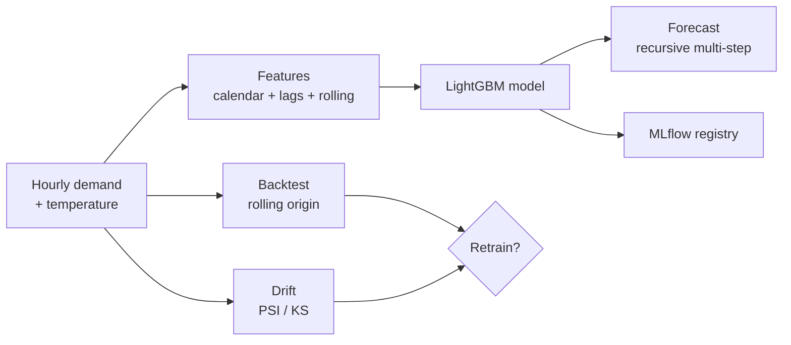

# GridCast

**Electricity demand forecasting with a full MLOps loop.**

GridCast forecasts hourly electricity demand with a gradient-boosted model, and it does
the parts that keep a model useful over time: it backtests with rolling origins, watches the input
data for drift, tracks every training run in MLflow, and decides when the model should be
retrained. It serves forecasts over a small API.

> GridCast runs on two data sources. A **synthetic** generator (daily, weekly and
> yearly shape, a temperature effect, a slow trend, noise) makes the components known,
> so tests can check the model recovers them and drift can be injected on purpose. And
> it is validated on **real** hourly Spanish grid demand (ENTSO-E, 2015-2016) — see
> *Validated on real grid demand* below. No private data is used.

[](.github/workflows/ci.yml)
[](pyproject.toml)
[](LICENSE)

---

## Why it exists

Training a model once is the easy part. The hard part is keeping it good: the weather
changes, demand patterns shift, and a model that was accurate last year quietly gets
worse. GridCast is built around that problem. It shows the MLOps loop end to end:

1. **Train** a model and **track** the run in MLflow (params, metrics, the model itself).
2. **Backtest** over several time windows, not one lucky split.
3. **Watch** the live data for drift.
4. **Decide** to retrain when the error is too high or the data has drifted.

## How it works



## Quickstart

```bash
python -m venv .venv && source .venv/bin/activate
make install
make demo          # train, backtest, drift check, and a retrain decision
make test          # full test suite
make run           # serve the API on http://localhost:8000 (docs at /docs)
```

`make demo` output looks like this:

```
1) Training ...        version m_...  holdout metrics {'mae': 0.28, 'rmse': 0.36, 'mape': 0.043}
2) Backtesting ...     backtest MAPE 0.054 over 3 folds
3) Drift check ...     drifted=True  temperature PSI=12.43
4) Retrain decision .. should_retrain=True  reasons=['input drift in: temperature, demand']
```

## The model

The forecaster is a `LightGBM` regressor on tabular features built from the series:

* **Calendar:** hour, day of week, month, weekend flag — this captures the daily and
  weekly shape.
* **Exogenous:** temperature.
* **Lags:** demand 24, 48, and 168 hours ago.
* **Rolling means:** 1-day and 1-week averages of past demand.

Forecasting more than one hour ahead is **recursive**: predict the next hour, add it to
the history, and use it to build the lags for the hour after. Metrics are MAE, RMSE, and
MAPE.

## MLOps parts

| Part | Module | What it does |
|---|---|---|
| Registry | `registry.py` | Logs every run to MLflow (params, metrics, model artifact) |
| Backtest | `backtest.py` | Rolling-origin: train, forecast a window, measure, roll forward |
| Drift | `drift.py` | PSI and KS between a reference window and the current window |
| Retrain | `retrain.py` | Flags a retrain when backtest error is high or drift is found |

Drift is detected with the **Population Stability Index (PSI)**: < 0.1 no real change,
0.1–0.25 some change, > 0.25 a big change.

## The API

| Method | Path | What it does |
|---|---|---|
| `GET` | `/health` | Liveness check |
| `GET` | `/model` | Active model version and metrics |
| `POST` | `/forecast` | Forecast the next N hours (`{"horizon": 48}`) |
| `GET` | `/drift` | Drift report for the recent window vs a reference window |

## Project layout

```
gridcast/
  data.py       synthetic hourly demand + temperature
  features.py   calendar, lag, and rolling features
  model.py      LightGBM forecaster + recursive multi-step forecast
  backtest.py   rolling-origin backtest
  drift.py      PSI / KS drift detection
  registry.py   MLflow tracking and registry
  retrain.py    the retrain decision
  service.py    the flow (train/forecast/drift/evaluate)
  main.py       FastAPI endpoints
  cli.py        train / backtest / drift / demo
```

## Validated on real grid demand

The synthetic generator proves the model recovers a pattern we built. To show it works
on data no one designed, GridCast is also benchmarked on **real** hourly Spanish grid
demand — the ENTSO-E transparency figures for 2015–2016 (17,512 hours, `total load
actual` in MW), joined with Madrid temperature, and vendored under
`datasets/spain_demand_real.csv` (see `datasets/README.md` for provenance and how to
refresh it with `gridcast.real_data.fetch_spain_demand`). Run `python -m
gridcast.real_benchmark`:

```
hourly rows        : 17512  (demand 18,041-40,324 MW)
one-step train/test: MAPE 0.0194 / 0.0359  (gap 0.0165)     -> well-fit

   horizon  folds  model MAPE  naive MAPE  TSO MAPE  model MAE
       24h      6      0.0496      0.1217    0.0144      1384MW
      168h      4      0.1194      0.1027    0.0118      3582MW
```

The benchmark lines the model up against two references:

- a **naive seasonal baseline** (last week, same hour) — the floor a useful forecaster
  must clear; and
- the **grid operator's own published day-ahead forecast** (`total load forecast`) — a
  professional reference built from a far richer feed (region-by-region weather
  forecasts, generation schedules, the holiday calendar).

**Day-ahead** — the operational horizon — the model's ~5.0% MAPE beats the naive
baseline (12.2%) comfortably and lands in the same low-single-digit range as the
operator's 1.4%, using only calendar parts, one city's temperature, and lagged demand.
The gap to the operator measures exactly what richer inputs would buy. A **full week
ahead**, recursive forecasting accumulates error until the last-week baseline becomes
competitive — the textbook signature of recursive multi-step forecasting, and the cue
to add a direct multi-horizon model for long lead times. The small one-step train/test
gap (1.7 pp) and the backtest error tracking the single-split held-out error confirm the
model is well-fit, not memorising. (`tests/test_real_benchmark.py` asserts all of this,
including that shuffling the demand column inflates the error — proof the model learns
real temporal structure, not noise.)

## Testing and quality

* **31 tests** cover data, features, the model, drift, backtesting, the retrain policy,
  the MLflow registry, the service, the API, and the **real-data benchmark** (the
  loader, the well-fit and beats-naive checks on real demand, the shuffled-label
  collapse, and the fetch/join path). CI requires at least 80% coverage.
* `ruff` for lint, `bandit` and `gitleaks` for security.

See [`docs/architecture.md`](docs/architecture.md), the [ADRs](docs/adr/), and the Spanish
study guide in [`docs/estudio/`](docs/estudio/).

## Notes

MLflow uses a local file store by default, which is fine for development and CI. In
production you point the tracking URI at an MLflow server with a database backend. In a
real system the temperature for future hours would come from a weather forecast; here the
API uses a simple "same hour last week" value for the future.

## License

[MIT](LICENSE) © Angelo David Padilla Romero
